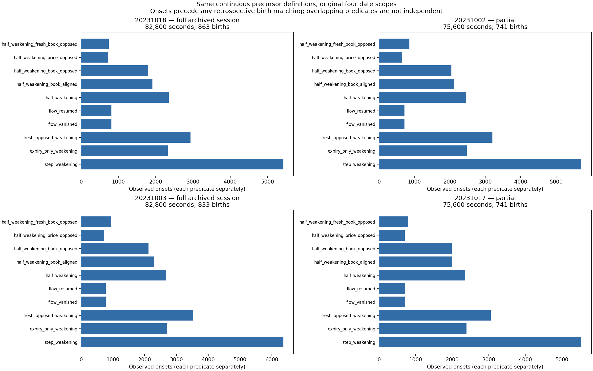

# Remaining October 18 extensions: four-date replication

Ran on a GitHub-hosted runner using pinned saved inputs. No producer, desktop computation, or simulator ran.

The continuous precursor scan and primer next-price-change/quote-age/reused-control diagnostics now cover each available date span. October 18 reproduces all eight continuous tables and three primer tables before the other dates run.

| Date | Scope | Groups | Births | Available seconds | Unique onset seconds |
|---|---|---:|---:|---:|---:|
| 20231018 | full archived session | 583688 | 863 | 82758 | 10383 |
| 20231002 | partial | 600291 | 741 | 75579 | 10932 |
| 20231003 | full archived session | 653912 | 833 | 82758 | 11928 |
| 20231017 | partial | 635170 | 741 | 75579 | 10602 |

Agreement, differences, and unresolved findings remain separate: the same algorithms and denominators are now available for comparison; equal procedures do not assert equal outcomes. All ten precursor hypotheses remain retained. Individual rows, causal clocks, unlinked onsets, flat/contrary outcomes and censored cases are preserved.

The separate 749-family-start study is NOT complete on the other dates: no equivalent saved family-start index is supplied by the sealed dipole inputs. The primer family subset remains October 18 only. No dipole was relabeled as a family. This receipt completes the missing extensions applicable to the archived Native populations, not the older ROOT/SQLite/Julia family pipeline.

Existing four-date modules remain at Markets commit 2ab66b7ab865e5c433a0140e81d693dd54da4903: original dipole operator, 11-arm stacks, matched prebirth, same-order aggression-to-rest paths, delayed observations, plus the published native-dipole renders. Timestamp assembly, other researchers' layers, and paper configuration follow this replication task; no paper orders have been submitted.
