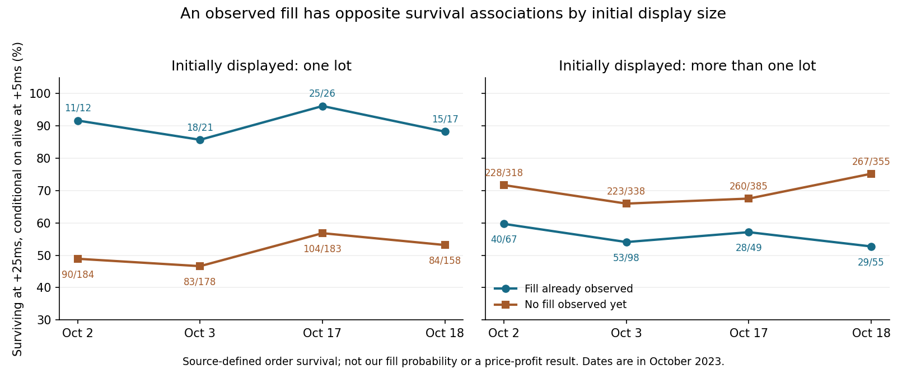

# Discovery addendum — 2026-11-09

This pass addresses the user’s correction: use the added depth to find new relationships, not merely summarize or validate existing findings. The preceding publication was finalized and remotely verified before this work began. The original top-ten rows and source cells remain frozen; exhaustive branch reconciliation is still deferred. “New” below means newly quantified or resolved in this pass, not a claim of first discovery anywhere in the prior research or literature.

Eight findings are below. The strongest new distinction is that **survival, replenishment and later price direction are different outcomes**. Another is a correction to the prior event-order interpretation. These change what the paper rules may claim.

## Method and scope

Questions were written in tasks/plan.md before viewing the new comparisons. All 628,672 priority records remain accounted for. The 3,176 recognition/context joins match by date, candidate identity and exact ns clock; all 17,284 resting observations reproduce the source prefix state; 38,736 existing original outcome rows are joined only as later outcomes. No native suite or old worker was restarted. No other analyst’s new report was read.

The pass retains 9,335 main group/target results, additional candidate/onset/price tables, all 548 field/day screens over 137 numeric family fields, and 2,424 cohort/control curve comparisons. These are overlapping, correlated exploratory comparisons, not independent replications or significance tests. All four dates have already been used for discovery. Thresholds and combinations were not optimized into a claimed winning strategy. Source volume terciles are retrospective complete-session categories.

Every reported orientation is explicit. P03 flow/book and moves are both pressure-relative; their product gives flow/book-oriented movement. P09 later moves are raw price ticks, multiplied by a nonzero contemporaneous direction where specified. Balanced/missing direction yields unavailable directional outcomes, not a fabricated flat return. P04/P05 supplementary price changes are converted from price units to ticks by dividing by 0.001. Clocks stay exact integer text.

## D01 — Fills mean different things for small and large residuals

At +5ms, one-lot starts with observed fills survived to +25ms in 69/76 cases (90.8%); without fills, 361/703 (51.4%). For larger starts the comparison reverses: 150/269 (55.8%) versus 978/1396 (70.1%). The direction of both contrasts holds on all four dates.

All 76 one-lot filled survivors had source-accounted implied added display by the decision, with zero unmatched fills. Price direction after observation remains mixed; larger filled survivors have negative mean 20s oriented changes on all four dates.

**Evidence:** P04 + P05; 38,736 existing original outcomes. **Implication:** Recommend R2 observation-only pending a direct test of the complete price-confirmed rule; log initial display, residual and replenishment separately.

| Initial display | State known at +5ms | Oct 2 | Oct 3 | Oct 17 | Oct 18 |
|---|---|---|---|---|---|
| 1 lot | known passive fill | 11/12 (91.7%) | 18/21 (85.7%) | 25/26 (96.2%) | 15/17 (88.2%) |
| 1 lot | no passive fill yet | 90/184 (48.9%) | 83/178 (46.6%) | 104/183 (56.8%) | 84/158 (53.2%) |
| >1 lot | known passive fill | 40/67 (59.7%) | 53/98 (54.1%) | 28/49 (57.1%) | 29/55 (52.7%) |
| >1 lot | no passive fill yet | 228/318 (71.7%) | 223/338 (66.0%) | 260/385 (67.5%) | 267/355 (75.2%) |

The contrast remains directionally the same for survival from +25ms to +100ms. Replaying the prefix actions verifies implied added display for every one of the 76 one-lot filled survivors; this is source-accounting evidence, not an assertion about hidden liquidity or intent.

| Initial display | Outcome | Oct 2 | Oct 3 | Oct 17 | Oct 18 |
|---|---|---|---|---|---|
| 1 lot | Observed fill; subsequent 20s ticks | -0.292 (n=12) | -0.714 (n=21) | 0.481 (n=26) | 0.059 (n=17) |
| >1 lot | Observed fill; subsequent 20s ticks | -0.396 (n=67) | -0.286 (n=98) | -0.173 (n=49) | -0.082 (n=55) |

## D02 — Interval definitions change the timing interpretation

Corrected source-interval comparison: 1,139 aggression intervals precede quote intervals; 682 quote intervals precede aggression; 1,335 overlap; one is censored.

The old smaller-index comparison conflated interval starts with sampled quote boundaries. Even non-overlap describes sampled source intervals, not proof about every native event. No verified 0.5s warning.

**Evidence:** P08 x07 producer + every saved event row. **Implication:** Supersedes the earlier event-order wording and active summary counts; raw source cells remain intact.

The aggressor index `a` denotes an event within `(a,a+1]` seconds after the anchor. The quote index `q` is the first sampled changed boundary, so its observed change lies in `(q−1,q]`. If `q=a+1`, the intervals overlap and order is unresolved. A smaller raw index alone is insufficient. This supersedes the previous 2,474/607/75 wording.

| Date | Aggression interval first | Quote interval first | Overlapping intervals | Missing |
|---|---|---|---|---|
| 20231002 | 273 | 133 | 335 | 0 |
| 20231003 | 372 | 157 | 294 | 1 |
| 20231017 | 250 | 173 | 317 | 0 |
| 20231018 | 244 | 219 | 389 | 0 |

## D03 — The cause of a flow flip changes its short-term persistence

After sign flips caused by classified arrivals without expiry, 5s same-sign persistence is 80.6–83.0% across dates; expiry without classified arrivals gives 62.0–65.8%. At 20s the advantage shrinks and is slightly reversed on Oct 3.

This concerns rolling flow state, not price. Window aging mechanically explains part of the contrast; unknown-side prints may still occur.

**Evidence:** P01; all 316,800 seconds; independent loop recount. **Implication:** Retain fresh/expiry/mixed provenance and update the state continuously; do not turn persistence into a price-return claim.

| Endpoint | Driver | Oct 2 | Oct 3 | Oct 17 | Oct 18 |
|---|---|---|---|---|---|
| same_sign_5s | classified arrival without expiry | 466/564 (82.6%) | 492/604 (81.5%) | 445/552 (80.6%) | 493/594 (83.0%) |
| same_sign_5s | expiry without classified arrivals | 483/748 (64.6%) | 475/723 (65.7%) | 398/642 (62.0%) | 465/707 (65.8%) |
| same_sign_5s | mixed arrival and expiry | 319/403 (79.2%) | 318/416 (76.4%) | 290/367 (79.0%) | 231/309 (74.8%) |
| same_sign_20s | classified arrival without expiry | 252/564 (44.7%) | 272/604 (45.0%) | 254/552 (46.0%) | 254/594 (42.8%) |
| same_sign_20s | expiry without classified arrivals | 304/748 (40.6%) | 328/723 (45.4%) | 269/642 (41.9%) | 286/707 (40.5%) |
| same_sign_20s | mixed arrival and expiry | 184/403 (45.7%) | 200/416 (48.1%) | 171/367 (46.6%) | 157/308 (51.0%) |

## D04 — Missing recent flow does not mean an empty market state

Fresh 5s flow is missing in 2,367/3,176 recognition contexts. With nonzero touch imbalance and available 20s outcomes in that group, touch-oriented means are positive on all four dates; they remain positive in the 60s-separated subset.

On identical jointly defined rows, touch beats fresh flow at 20s on three dates and loses on Oct 18. The small midpoint effects are not net executable returns.

**Evidence:** Exact P09–P10 candidate/time join; no unmatched identities. **Implication:** Retain quiet-flow book/price observations. R1 fresh-flow gating remains a hypothesis to evaluate, not universal decision coverage.

## D05 — Short-flow direction depends on the longer flow state

Family 5s/60s flow agreement produces higher 20s flow-oriented mean movement than disagreement on all four dates: differences 0.709, 0.461, 0.119 and 0.485 ticks. Disagreement itself is negative on Oct 2/3 and positive on Oct 17/18.

Retrospective family selection and an outcome reference before the family start include onset mechanics. This does not test R1 execution or isolate causality. The agreement advantage also holds at 5s, but reverses at 60s on Oct 17 and Oct 18; it is horizon-dependent.

**Evidence:** P02 complete families; P03 pressure/side/volume and separated-event comparisons. **Implication:** Useful context for the R1 hypothesis, with disagreement retained for comparison. No threshold optimization or new performance promise.

| 5s versus 60s flow | Oct 2 | Oct 3 | Oct 17 | Oct 18 |
|---|---|---|---|---|
| aligned | 0.439 (n=464) | 0.189 (n=461) | 0.308 (n=469) | 0.624 (n=418) |
| opposed | -0.271 (n=194) | -0.272 (n=204) | 0.189 (n=201) | 0.139 (n=147) |

## D06 — How a quote became thin changes the interpretation

The pooled origin comparison mixes NEW_BEST with STANDING_BEST_SHRANK. Within first-observed orders whose standing best shrank, size-cut origins retreat more often than older-resting origins on every date. Older resting at NEW_BEST is not uniformly worse than fresh adds.

Origin and onset mechanism are strongly entangled. The same one-lot size is not the same state. Outcomes describe the source quote episode, not our trade PnL.

**Evidence:** P07 all 101,066 onsets; 89,072 unique day/order first observations. **Implication:** Log onset mechanism and prior history; avoid a generic one-lot weakness trigger.

## D07 — Apparent confirmation often repeats the same execution

Bid-side passive fills and sell-aggressor quantities over 5s have Spearman correlations 0.990–0.994 across dates. Their separate associations with later price are not independent confirmations.

The 137-field screen is exploratory and highly dependent. Small associations remain visible; no row-level significance or best-feature claim is used.

**Evidence:** P02 field screen, all 548 field/day comparisons and redundancy checks. **Implication:** Prevent double counting flow, passive fills and matched display reductions in a score.

## D08 — Birth-aligned buildup and recognition-time information differ

At −5s from retrospective birth, median birth-oriented lean is 0.419–0.500 versus zero in matched-control medians. Yet defined-flow share at −5s is near the controls and at recognition fresh flow is often empty.

Birth identity and orientation are retrospective; control bands summarize 200 draws, not independent-day confidence. Prebirth 20s total-volume differences are below controls on all four dates, while direction/depth differences vary.

**Evidence:** P06 matched pairs + P08 all 404 cohort/control boundary pairs + P09/P10. **Implication:** Retain formation explanations without presenting future-aligned curves as an online early warning or sufficient market model.

## What the combined evidence adds

The new data supports separating three axes: **what changed**, **what remains observable**, and **what price does next**. A one-lot residual refilled after executions is different from a large residual being depleted; both can show “fills known.” A flow sign change due to expiry is different from a new classified trade; both can show a sign flip. A birth-aligned curve can explain the completed formation while being unavailable as a prospective birth signal. Touch depth, full depth and order-count imbalance also need separate roles.

Dipole information remains useful for formation, clocked context, empty/weakening/strengthening states and prospective hypotheses. This pass does not show that dipole layers alone cover executable direction, remaining duration, exit or reversal. Additional order, book, price-path and execution information changes the interpretation. No percentage of “market understanding explained” is claimed. Ancestry, whole-parent lifespan and the archived stage series are not newly recomputed here.

## Verification and coverage

Independent checks read all 17,284 actual P05 Excel rows and reproduced the 16 size/fill/day survival counts. A separate loop over all 316,800 native seconds reproduced the 12 day/driver 5s persistence counts. Six focused tests cover exact-ns joins, duplicate identities, boolean source labels, balanced versus missing directions, pressure orientation and interval ordering. The original cell-verification receipt remains the authority for the frozen 17,692,811 new source cells. Cases are selected deterministically, with both surviving and failed states; the full populations determine every result.

COVERAGE.csv preserves all 439 source fields with review roles and explicit unresolved interpretation. Administrative fields retain lineage. Fields not independently resolved are not counted as completed substantive explanations. The complete prior 141-layer trade workbook is retained; this pass does not claim fresh interpretation of every historical layer, every source branch file or every possible combination. OPEN_QUESTIONS.md separates execution blockers from broader deferred interpretation.

## Paper consequences

Read PAPER_READINESS.md and PAPER_STRATEGIES_v1_1.json. R1 remains a hypothesis awaiting paper execution checks. R2 becomes observation-only in the new readiness version because order survival is not demonstrated directional advantage. The original v1 is preserved for audit; no live or paper execution started. All risk limits remain provisional operating controls, not fitted optima. No spread-, fee- and latency-adjusted strategy performance is claimed.
