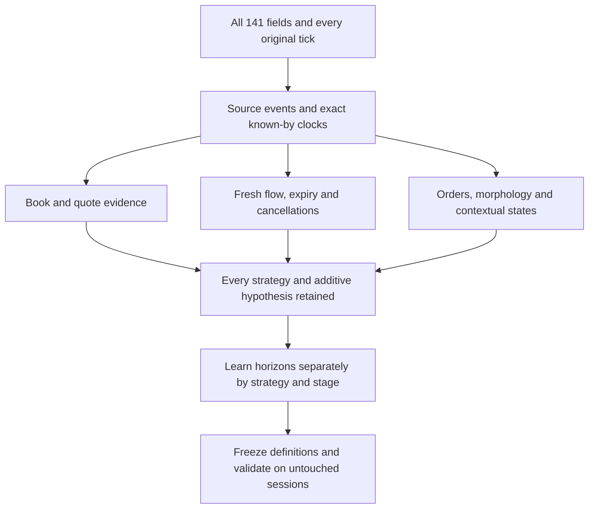

# Codex evidence and availability continuation — November 13, 2026

**CORRECTION: this is an audit of the original incomplete field grid, not a rebuilt dataset.** [Read the correction for Claude and Codex first](CLAUDE_INPUT_CORRECTION.md). The user requires field reconstruction before further strategy research. Later published recovery data were omitted by the old case assembler. Exactly 78 original columns are empty in every row, and the original eight categories were selected by trade prints, not quote movement. Rebuild work supersedes the research continuation order below.

All **141 fields, 32 cases and 5,513 original tick appearances** are preserved and audited. The evidence map connects C1–C15 to exact operands, source-event families, availability clocks and unresolved dependencies. The original five and eleven legacy arms remain separately retained. Six new research hypotheses are additive; fifteen is not a ceiling. No strategy has been eliminated, ranked into a single winner, backtested or executed in this increment.

**The user's horizon correction is incorporated:** 5s/60s and other inherited time constants are archived baselines only. New horizon parameters are unset and must be learned from development data by strategy and trade stage, then frozen for untouched validation. [Horizon research protocol](HORIZON_RESEARCH.md) explains the time/event axes, source-clock choices, censoring, temporal splits and versioning requirements. It does not claim a fitted horizon.

The [machine-readable horizon registry](HORIZON_REGISTRY.json) explicitly stores `null` values and no fallback defaults for the new variants.

## Start with the evidence map

- [Strategy → fields → source events → exact clocks → dependencies](EVIDENCE_MAP.md)
- [All 141 original fields, individually accounted for](ALL_141_FIELDS.md)
- [Machine-readable strategy and hypothesis map](strategy_evidence_map.json)
- [Every field in every case: 4,512 records](field_case_audit.csv)
- [Each observed numeric member: 8,326 case/member records](numeric_member_audit.csv)
- [Exact clocks for every tick](tick_clock_ledger.jsonl.gz) and [source row joins](source_group_joins.jsonl.gz)
- [Preserved complete cases](raw/) and [saved prior review artifacts](prior/)



The diagram describes dependencies. It does not assert a universal causal ordering between flow, liquidity and price.

## Findings from this pass

1. **The full grid is intact.** Each case was compressed directly from its original bytes and decompressed byte-for-byte for verification. The 141 source fields and 26 contextual columns remain, including structured payloads, missing states and the complete second-level context. No tick sampling, smoothing, replacement score or reduced field view was created. All 5,513 day/trade ordinals are unique within these 32 cases; before/during groups are reused across rows and must not be treated as independent events.
2. **5,500 of 5,513 trade rows have a during-state availability clock later than the trade's receive clock.** All 11,026 before/during joins matched the corresponding immutable group-source rows, across 9,505 unique groups. Checked scalar depth/count/quote operands and during-group cursors matched. Thus a during-state can be used at its completed-group decision, but cannot be backdated to the individual print. The exact delays remain in the tick ledger; no rounded seconds replace them.
3. **Recognition remains a different clock from birth.** It falls after the selected leg in 25 cases, before it in five and during it in two. Every case retains birth label, birth known-by, recognition, leg start/end and end label/known-by clocks. Recognition-only strategies cannot be retroactively armed at birth. The late cases remain valid research observations, not discarded examples.
4. **Most named layers are not populated live measurements in this grid.** The 131 layer columns comprise 58 always `NO_MATCHING_VALUE_IN_RETAINED_INPUT`, 20 always `MISSING_STATIC_SOURCE`, five `STATIC_KNOWLEDGE_PINNED`, 15 `ORIGINAL_VALUES_JOINED`, one `ORIGINAL_TRADE_OPERANDS_ONLY`, 13 external publication layers and 19 S layers present only on October18. The ten metadata fields complete the 141. These are storage-status categories, not rankings of utility. Missing layers remain recovery tasks.
5. **S-state masking materially changes what can be examined.** On October18, all 27,493 S cells at `at_trade_input` are missing (19 fields × 1,447 ticks). At emission close, 20,637 slot observations are PRESENT and 6,856 missing; the prior-completed slot has 19,786 PRESENT and 7,707 missing. Previous-input has 18,812 PRESENT and 8,681 missing. These counts are field/slot observations, not independent samples. The other three dates do not have S payloads. Producer semantics and the previous-input clock still need verification.
6. **S05 and S13 are exactly equal as full stored cell streams in this sample.** Their different names—far identity survival and far size retention at 1024—do not establish independent evidence here. This could be an actual sample relationship or an upstream projection/alias issue; the audit does not decide which. Preserve both and inspect their producer lineage. Other exact duplicate groups are missing/static payloads. Known overlaps between L039/L045/L057 and L052/L054 remain operand duplication, even when complete serialized cells differ.
7. **External values do sometimes change inside a case.** X05 wind and X07 estimated gas burn vary in October18 large-up-brief; X10 observed HDD varies in October17 large-up-lasting and October18 large-up-brief. X13 curve operands vary in 16 cases. These are state-masked member-inventory findings, not directional or causal results. All checked declared publication times precede their as-of receives, but actual delivery and vintage proof remain unresolved. Derived publication timestamps are not upgraded to verified release receipts.
8. **Underlying action/group sources are available.** All 123 referenced source blobs checked against Git blob hashes. Action schemas include order identity, before/after state, fill-linked reduction, group ordinal and known-by time. This supports the next reconstruction work; it does not establish a completed order ledger, cancellation classification, arbitrary flow window, FIFO feature or execution result.

## All eight types across all four days

Counts below are full-window trade appearances, including padding; they are not strategy outcomes. Exact boundaries and durations are in [case_manifest.json](case_manifest.json).

| Trade type | Oct 2 | Oct 3 | Oct 17 | Oct 18 |
|---|---:|---:|---:|---:|
| Large up lasting | 159 | 95 | 326 | 179 |
| Large up brief | 173 | 428 | 101 | 586 |
| Large down lasting | 113 | 246 | 156 | 73 |
| Large down brief | 71 | 108 | 105 | 230 |
| Small up lasting | 98 | 173 | 154 | 87 |
| Small up brief | 98 | 346 | 130 | 41 |
| Small down lasting | 95 | 207 | 89 | 158 |
| Small down brief | 231 | 151 | 213 | 93 |

The 16 brief selected legs span 300,464 to 19,161,537 nanoseconds. That is a reason to study source cadence and executable response delay rather than impose multi-second signal windows; it does not imply that those bursts can be traded after recognition or that leg duration supplies a live horizon.

## Additive research beyond C1–C15

H16 investigates flow-to-quote response delay. H17 investigates divergence between displayed lots and order counts. H18 investigates cancellation-to-liquidity-return timing. H19 compares print movement with quote relocation. H20 investigates individual information-state and age/survival inputs. H21 examines external vintage and local-state interaction. Each has explicit evidence bindings, dependencies and an individual-event research protocol in the map. These are research hypotheses, not six newly implemented strategies.

## What remains, in dependency order

1. Extend the verified projected joins to continuous event streams, including non-trade groups, snapshots, resets, warmup and contract/session boundaries. Exact scalar source parity is already checked for this selected grid.
2. Reconstruct native arrivals/expiry and order/cancellation mechanics. Keep touch/full-book and old/new-touch scopes separate. Verify state semantics before deriving features. Source presence and hash integrity do not substitute for this work.
3. Resolve S producer/slot lineage, external release/delivery and original model input parity. Missing optional context should not silently veto a strategy whose required measurements are otherwise evaluable.
4. Learn and lock strategy/stage-specific horizon variants following the horizon protocol. Reconstruct longer context if the empirically supported horizons exceed current padding. Preserve original native ratio and all original measurements beside any new derived versions.
5. Implement independent research/paper ledgers once definitions and execution contracts are concrete. Log every opportunity, unknown/no-fill/paused state, warning and exit. Add untouched sessions; these outcome-selected examples and the already-read October16 replay are development evidence.

No filtering or elimination is introduced by this ordering. A missing dependency means the relevant measurement or rule is currently unevaluable. It is not a false condition, zero return or rejected hypothesis. Predictive validity, execution economics and useful operating regions remain open.

## Provenance and independence

This continuation starts from the saved review reproduced at `prior/HANDOFF.md.gz` and the immutable [fifteen-strategy commit](https://github.com/DavisAI1974/markets-data/commit/fe45d2eff9b389e00c80807b6e2240003ba4885d). The prior artifacts already incorporate older Claude material supplied before this task. Claude's **new** independent exercise was not opened or used. Its directory/branch name was encountered in repository inventories only. No new Claude output influenced these findings or additions.

The publication worktree is isolated from the original Markets repository and the dirty research publication checkout. Original five and legacy rules remain unchanged in the branch ancestry. Local machine paths embedded inside preserved originals are provenance strings; the committed compressed cases and pinned GitHub source URLs are the durable data references.

## Reproduce and verify

The standalone checks require only Python's standard library:

```text
python -m unittest discover -s . -p test_audit.py
python verify_package.py
```

Rebuilding the audit uses the original case/review directories and content-addressed source cache:

```text
python audit.py --source <case-directory> --prior <review-directory> --catalog <published_source_catalog.json> --objects <object-directory>
python build_map.py
python verify_source_groups.py --objects <object-directory>
python verify_package.py
```

The source-group verifier additionally requires PyArrow; it accepts `--python-deps` for an existing dependency directory. No dependency installation or data mutation is required. Run `build_map.py` after `audit.py` to restore the strategy-role annotations. The audit reads only explicitly named prior sources and immutable original event blobs.

[Audit checks](AUDIT_VERIFICATION.json), [source joins](SOURCE_JOIN_VERIFICATION.json), and [publication-package integrity](PACKAGE_VERIFICATION.json) passed. Eight focused tests cover missing-zero/state handling, nested numeric payloads, exact integer clocks and unknown availability. New strategy execution and horizon fitting both remain **not started**.
