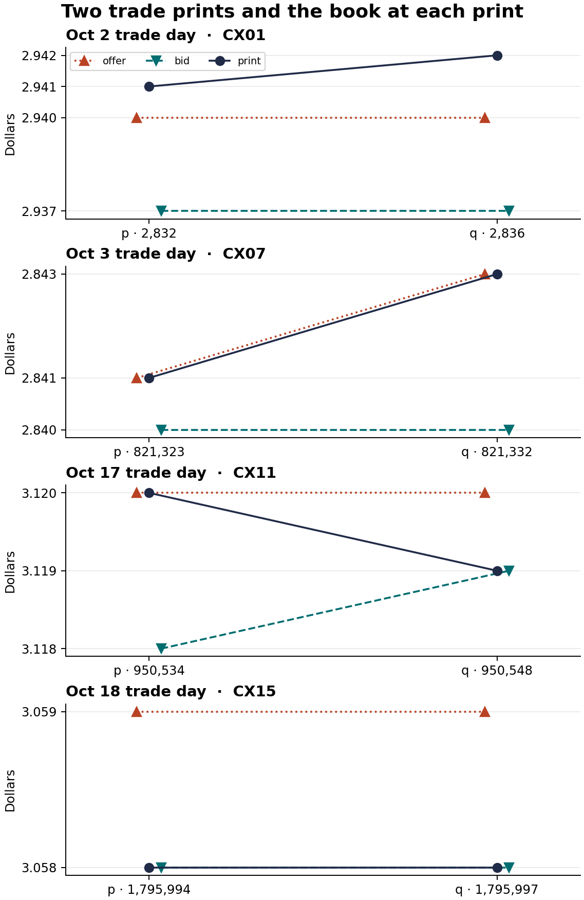

# What the rebuilt tape shows

A higher print, a higher bid and another buyer entering are three different observations. The Oct 2 trade day shows why: the price stepped up inside a single exchange event while both quotes stood still. The Oct 17 trade day shows the converse: a seller printed lower while the bid stepped up. Those two cases led to different rules for opening a position and staying in one.

Each panel has its own dollar scale. The marks show the two observed endpoints; connecting lines guide the eye across intervening tape rows. Horizontal spacing represents tape order, not elapsed time.

## Four passages that changed the specifications

- **Oct 2 trade day, CX01.** Positions **2,832 → 2,836**. Print 2.941 → 2.942, bid 2.937 → 2.937, offer 2.940 → 2.940. D 0.38461538461538464 → 0.4666666666666667, E 0.2 → 0.3333333333333333. At q the aggressor is a buyer. Exchange events 2,829 → 2,829. Received ns 1696197781525192447 → 1696197781525192447. [book and prints 000](https://github.com/DavisAI1974/markets-data/blob/360fdaa2ba692e22d4c68c5a583ca89496533289/rows-20231002-part000.parquet) · [stored lines](https://github.com/DavisAI1974/markets-data/blob/360fdaa2ba692e22d4c68c5a583ca89496533289/calc-research_columns-20231002-part000.parquet). [All fifteen cases for this trade day](observations/20231002.md).

- **Oct 3 trade day, CX07.** Positions **821,323 → 821,332**. Print 2.841 → 2.843, bid 2.840 → 2.840, offer 2.841 → 2.843. D 0.0 → -0.25, E -0.6666666666666666 → 1.0. At q the aggressor is a buyer. Exchange events 821,323 → 821,332. Received ns 1696284242105041198 → 1696284293446774127. [book and prints 000](https://github.com/DavisAI1974/markets-data/blob/c8a0b758057b4fc620c535682783242e61b2e713/rows-20231003-part000.parquet) · [stored lines](https://github.com/DavisAI1974/markets-data/blob/c8a0b758057b4fc620c535682783242e61b2e713/calc-research_columns-20231003-part000.parquet). [All fifteen cases for this trade day](observations/20231003.md).

- **Oct 17 trade day, CX11.** Positions **950,534 → 950,548**. Print 3.120 → 3.119, bid 3.118 → 3.119, offer 3.120 → 3.120. D 1.0 → 0.3333333333333333, E 1.0 → 0.3333333333333333. At q the aggressor is a seller. Exchange events 950,534 → 950,548. Received ns 1697493823298825080 → 1697493840644859921. [book and prints 000](https://github.com/DavisAI1974/markets-data/blob/733442aee6ff02f6417ba44aa74f792496ef1fa2/rows-20231017-part000.parquet) · [stored lines](https://github.com/DavisAI1974/markets-data/blob/733442aee6ff02f6417ba44aa74f792496ef1fa2/calc-research_columns-20231017-part000.parquet). [All fifteen cases for this trade day](observations/20231017.md).

- **Oct 18 trade day, CX15.** Positions **1,795,994 → 1,795,997**. Print 3.058 → 3.058, bid 3.058 → 3.058, offer 3.059 → 3.059. D 0.2972972972972973 → 0.23076923076923078, E 0.058823529411764705 → -0.05263157894736842. At q the aggressor is a seller. Exchange events 1,795,994 → 1,795,997. Received ns 1697580027510058689 → 1697580027510298164. [book and prints 000](https://github.com/DavisAI1974/markets-data/blob/1bd670ef1ba9f74a11bfcde3a50f59c18720f4df/rows-20231018-part000.parquet) · [stored lines](https://github.com/DavisAI1974/markets-data/blob/1bd670ef1ba9f74a11bfcde3a50f59c18720f4df/calc-research_columns-20231018-part000.parquet). [All fifteen cases for this trade day](observations/20231018.md).

The Oct 2 passage motivates requiring a distinct exchange event in CX01 and CX02. The Oct 3 passage motivates tracking whether the other quote follows in CX07 and CX08. The Oct 17 passage motivates testing a hold against the quote on which the aggressor just traded in CX11 and CX12. The Oct 18 passage motivates CX15’s unchanged quote endpoints. The individual sections below also show where the same basic flow setup coexists with a different price or book observation.

## Evidence for every strategy

Each trade day has its own page covering CX01 through CX15. Each strategy has two separately sourced passages where available: one showing all proposed market conditions and one showing why the original observation alone leaves the interpretation open. The first qualifying or contrasting pair in tape order is shown, without looking at later prices. The ledger retains **every** pair matching any v1 setup on that trade day with its actual p and q, including overlapping ideas. This is an inventory of observed market conditions, not an activation log. Position state and prices after q are outside this discovery step.

| 2023 trade day | Read individual cases, including contrasting evidence | Download every matching pair |
|---|---|---|
| Oct 2 | [Cases](observations/20231002.md) | [Pair ledger](observations/pairs-20231002.parquet) |
| Oct 3 | [Cases](observations/20231003.md) | [Pair ledger](observations/pairs-20231003.parquet) |
| Oct 17 | [Cases](observations/20231017.md) | [Pair ledger](observations/pairs-20231017.parquet) |
| Oct 18 | [Cases](observations/20231018.md) | [Pair ledger](observations/pairs-20231018.parquet) |

In each Parquet file, p and q have received and exchange nanoseconds, tape place, exchange event, print, bid, offer, displayed quantities, reported side and both stored line readings. Price fields are integer nanodollar units or their exact numeric equivalents. D and E are the original stored doubles. Bare CX columns mark the first rule sheet’s market setup. The corresponding v2_market column includes the more specific book, event or aggressor observation used in the paper version. A false value describes absent conditions at that pair. Each record stops at q. The original branch retains every other valid tick. [Reproduce the observations](trace_pairs.py)

From a directory holding a named shallow checkout, run `python trace_pairs.py /path/to/20231002 /path/to/output` with Python, pandas, NumPy and PyArrow. Repeat with the matching checkout for each trade day. The checkout directory name is its eight-digit trade date. Source snapshots and the fields checked are recorded in [the access record](ACCESS_RECORD.md).
